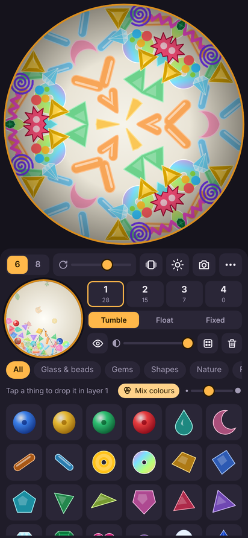

# Kalejdo

Ett kalejdoskop för mobilen. Speglarna visar en tårtbit av behållaren längst fram i tuben,
och bilden byggs upp av 6 eller 8 speglade tårtbitar. Behållaren fylls med små roliga prylar
ur ett bibliotek med SVG-filer, i fyra lager som fylls var för sig.

## Så fungerar det

- **Kalejdoskopet** överst. Dra runt med fingret för att vrida behållaren. Ett tryck stoppar eller
  startar den automatiska rotationen. Dubbeltryck ger helskärm, och dubbeltryck igen tar tillbaka kontrollerna.
- **Helskärm** fyller hela skärmen med ett sömlöst mönster av kalejdoskopbilden. Med 6 tårtbitar blir det
  sexhörningar i bikakemönster. Med 8 tårtbitar blir det åttahörningar med snedställda kvadrater
  emellan. Grannarna är spegelbilder av varandra. Plattornas storlek ställs in under ⋯ (*Pattern size*).
- **6 / 8** väljer antal tårtbitar.
- **Snurr-reglaget** styr bara farten. Längst till vänster är stilla. Pilknappen till höger om reglaget
  växlar riktning, och play/paus-knappen till vänster stoppar och startar rotationen utan att ändra farten.
- **Skaka** ger allt löst i behållaren en knuff.
- **Ljus** växlar bakgrundsljuset: Daylight, Warm lamp, Sky, Sunset, Night och Rainbow.
- **Kameran** sparar bilden i *Bilder/Kalejdo* (i webbläsaren laddas den ner).
- **Webbversion:** `index.html` + `props/` kan läggas på vilken webbserver som helst. Se `CLAUDE.md`.
  *Tilt to tumble* kräver https, och på iPhone frågar Safari om lov att använda rörelsesensorn.

## Behållaren och lagren

- Den lilla runda bilden till vänster är behållaren. Valt lager syns tydligt och de andra är nedtonade.
  Den streckade tårtbiten visar vilken del speglarna ser. Dra i bilden för att vrida, och tryck på en pryl
  för att ta bort den ur valt lager (med Ångra).
- Behållaren har fyra lager, **1–4**. Siffran under visar hur många prylar lagret har (högst 40).
  Lager 1 ritas längst bak och lager 4 längst fram.
- Varje lager har ett eget beteende:
  - **Tumble:** prylarna faller, rullar och studsar när behållaren vrids.
  - **Float:** prylarna svävar tyngdlöst och följer långsamt med vätskan.
  - **Fixed:** prylarna sitter fast och vrids med lagret.
- **Hastighet per lager:** hastighetsreglaget (×0,1–1,9) anger hur fort lagret vrids jämfört med huvudreglaget.
  Pilknappen får lagret att vridas åt motsatt håll. Fliken visar t.ex. *↺×0.6* när lagret avviker
  från huvudreglaget.
- **STOP-märket** låser lagret, så att det står helt still medan resten vrids. Ett litet rött märke på fliken
  visar att lagret är låst. Tryck igen så vrids lagret med igen från där det står.
- Ögat döljer eller visar lagret. Det vänstra reglaget ändrar genomskinligheten. ⌫ tar bort den senast
  tillagda prylen (med Ångra). Tärningen fyller på med tio slumpvisa prylar ur vald kategori, och
  papperskorgen tömmer lagret.
- Allt sparas i telefonen, så kalejdoskopet ser likadant ut nästa gång.

## Biblioteket

- Tryck på en pryl för att släppa ner den i valt lager.
- **Mix colours** ger varje ny pryl en slumpad färgton. Stäng av för originalfärgerna.
- Storleksreglaget gäller nya prylar.
- Under **⋯** finns även *Spin inertia* (hur trögt prylarna snurrar runt sin egen axel) och *Gravity*
  (hur hårt prylarna i Tumble-lager faller).
- Under **⋯** finns *Tilt to tumble* (tyngdkraften följer hur man håller telefonen), *Field of view*
  (hur stor del av behållaren speglarna ser), helskärm, töm allt och startblandningen.

## Egna prylar

Prylarna är vanliga SVG-filer i `props/<kategori>/`. Det finns 235 stycken i tio kategorier:
glas och pärlor, ädelstenar, former, natur, mat, djur, saker, Electro (motstånd, kondensatorer, spolar,
IC-kretsar, transistorer, lysdioder m.m.), Christmas (julpynt, bl.a. julbock, lussekatt
och tomte) och evaQ8 (utrymningsskyltar, brandskyltar, förbuds- och varningsskyltar samt brand- och
utrymningsutrustning). evaQ8-prylarna behåller alltid sina färger, även när *Mix colours* är på.

- Lägg till en pryl genom att ladda upp en `.svg` i en kategorimapp, t.ex. `props/food/taco.svg`.
  Filnamnet blir namnet i biblioteket (`taco` → *Taco*).
- En ny mapp blir en ny kategori. Vill du ge den ett snyggare namn, lägg en fil `_category.txt`
  med namnet på första raden i mappen.
- Rita prylen så att den fyller en kvadratisk `viewBox` (t.ex. `0 0 100 100`) med lite marginal.
- GitHub Actions kör `tools/build_index.py` före varje bygge, så nya filer kommer med i appen automatiskt.
  För webbversionen kör man skriptet själv och checkar in `props/index.json`.

## Teknik

- Själva kalejdoskopet är `index.html` plus `props/`, utan beroenden. Det går att köra i en webbläsare
  (via en webbserver eller GitHub Pages, inte som lös fil).
- Android-appen är ett tunt WebView-skal i stående läge. Innehållet hålls innanför statusfältet och
  navigeringsfältet.
- GitHub Actions bygger en test-APK vid varje push till `main`. Den publiceras som
  senaste release: `releases/latest/download/kalejdo-debug.apk`.
- Appen kräver Android 10 eller senare. Den har inga annonser och ingen spårning, och den använder inget nätverk.
